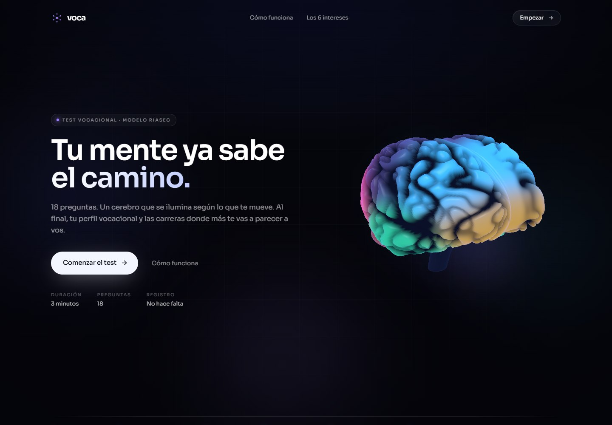
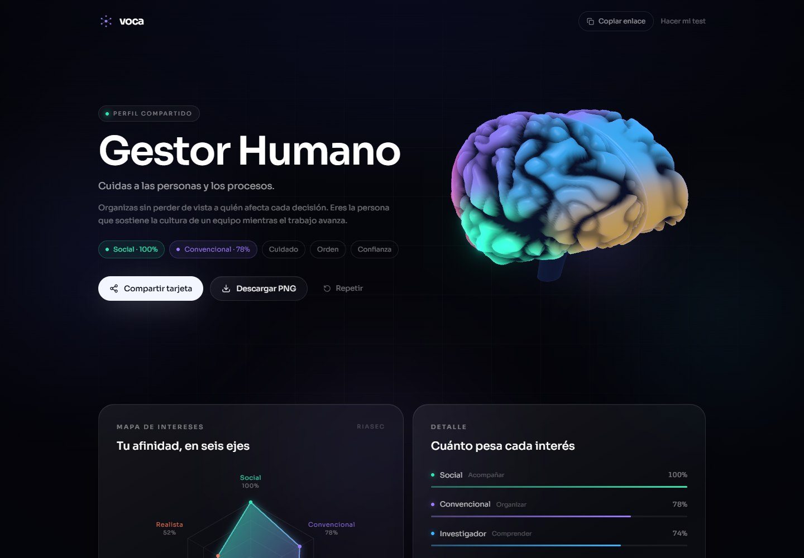
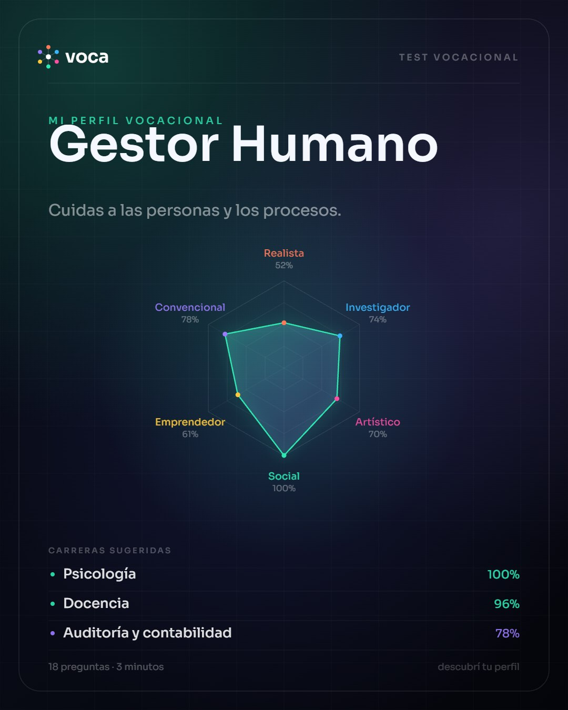
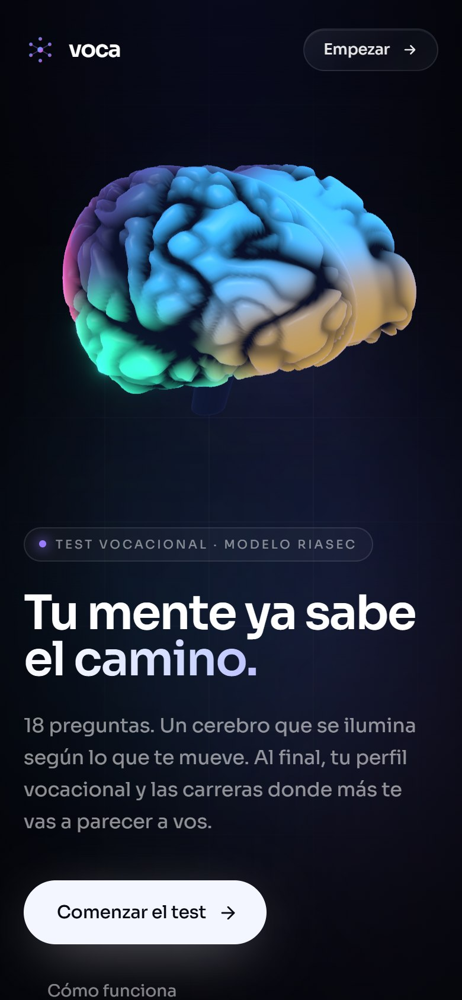

# voca

**Test vocacional RIASEC con un cerebro 3D que se ilumina según lo que te mueve.**

18 preguntas, un cerebro 3D que reacciona a cada respuesta y un perfil final con gráfico de afinidad, carreras sugeridas y una tarjeta lista para compartir.



---

## Qué es

`voca` es un test vocacional basado en el modelo **RIASEC** de John Holland. Cada pregunta alimenta seis intereses —Realista, Investigador, Artístico, Social, Emprendedor y Convencional— y el cerebro que acompaña la experiencia se enciende por zonas a medida que esos intereses acumulan peso.

Al terminar, la app arma un perfil combinado (por ejemplo _Creativo-Analítico_), muestra la afinidad en un radar y sugiere cinco carreras ordenadas por compatibilidad. El resultado se puede compartir como enlace o como imagen de 1080 × 1350.

| Resultado                                            | Tarjeta compartible                            | Mobile                                   |
| ---------------------------------------------------- | ---------------------------------------------- | ---------------------------------------- |
|  |  |  |

---

## Cómo funciona

**1. El test.** 18 afirmaciones, una por pantalla, con una escala de cuatro niveles (_Nada · Poco · Bastante · Mucho_). Se puede responder con el mouse, con el dedo o con las teclas `1` a `4`. La respuesta avanza sola después de 280 ms y el progreso queda guardado en el dispositivo.

**2. El cerebro.** Cada interés tiene una zona propia en el cerebro. Al responder, esa zona pulsa y queda encendida con una intensidad proporcional al puntaje acumulado.

**3. El perfil.** Con las respuestas se calculan los seis puntajes, se ordenan y se elige el perfil combinado de los dos intereses dominantes.

### Puntaje

Cada pregunta tiene un interés **principal** y uno **secundario**. La respuesta vale de 0 a 3 y se pondera:

|                    | Peso | Aporte máximo  |
| ------------------ | ---- | -------------- |
| Interés principal  | 3    | 9 por pregunta |
| Interés secundario | 1    | 3 por pregunta |

La afinidad que se muestra es **relativa al interés más alto**: el dominante siempre marca 100 % y el resto se expresa en proporción. Si la diferencia entre el interés más alto y el más bajo es menor a 25 puntos, el perfil se marca como _equilibrado_.

> Es una herramienta de orientación, no un diagnóstico clínico.

---

## El cerebro 3D

El cerebro es un modelo real (`cerebro.glb`, 1,9 MB) con el mapa de intereses horneado por vértice. **El modelo no está incluido en el repositorio**: se coloca en `public/cerebro.glb`. Si el archivo no está, la escena cae al cerebro procedural y todo lo demás funciona igual.

No se usa el material del GLB: la escena monta un `ShaderMaterial` propio que lee esos atributos y pinta cada zona.

- **Pesos por vértice.** El modelo trae dos atributos de cuatro componentes: `_ZONEA = (R, I, A, S)` y `_ZONEB = (E, C, tronco, cavidad)`. Todos en 0–1, así que el shader sabe cuánto pesa cada interés en cada punto de la superficie.
- **Zonas encendidas.** Cada zona emite `color_i × peso_i × nivel_i`, donde el nivel (0–1) sale del puntaje acumulado. Al responder, la zona suma un pulso corto que decae en menos de un segundo.
- **Surcos.** La cuarta componente de `_ZONEB` es la profundidad del surco: 0 en la cresta de un giro, 1 en el fondo. Se usa como oclusión: oscurece el albedo, apaga la emisión y corta el brillo de borde, así las circunvoluciones se leen sin mapa de normales.
- **Tronco encefálico.** `_ZONEB.z` lo identifica y lo excluye del mapa de intereses.
- **Acabado.** Luz de estudio con clave y relleno, un especular tenue solo en las crestas, Fresnel frío en el contorno y Bloom suave sobre las zonas más encendidas.
- **Vista 3/4.** El cerebro arranca en tres cuartos, oscila lentamente en Y y acompaña al puntero con una parallax mínima.
- **Carga diferida.** El canvas se monta con `next/dynamic` y `ssr: false`; el GLB se pide con `useGLTF` dentro de un `Suspense`, con un halo de respaldo mientras llega el chunk de Three.js.
- **Red de seguridad.** Si el GLB no carga o no trae los atributos de zona, la escena cae a un cerebro procedural generado por código (`procedural-brain.tsx`), así la página nunca queda vacía.

---

## Stack

| Capa         | Herramientas                                               |
| ------------ | ---------------------------------------------------------- |
| Framework    | Next.js 15 (App Router), React 19, TypeScript              |
| Estilos      | Tailwind CSS 3, tipografía Sora (`next/font`)              |
| Animación    | `motion` (Framer Motion) para UI, `useFrame` para el 3D    |
| 3D           | Three.js + React Three Fiber + drei (`useGLTF`)            |
| Postproceso  | `@react-three/postprocessing` (Bloom)                      |
| Iconos       | `lucide-react`                                             |
| Persistencia | `localStorage` + enlaces con hash, API opcional en memoria |

---

## Estructura

```
public/
└─ cerebro.glb              # Modelo local (ignorado por git)
src/
├─ app/
│  ├─ page.tsx              # Portada: hero + cerebro + intereses
│  ├─ test/page.tsx         # Flujo de 18 preguntas
│  ├─ resultado/page.tsx    # Perfil, radar, carreras y tarjeta
│  ├─ api/results/route.ts  # Backend mínimo opcional
│  ├─ layout.tsx            # Fuente, metadata, tema oscuro
│  └─ globals.css           # Tokens, glass, gradientes, grano
├─ components/
│  ├─ brain/                # GLB + shader, escena, cámara y fallback
│  ├─ results/              # Radar SVG y preview de la tarjeta
│  ├─ test/                 # Escala de respuesta
│  └─ ui/                   # Botones, fondo, logo, reveals
└─ lib/
   ├─ riasec.ts             # Intereses, colores, perfiles y carreras
   ├─ questions.ts          # 18 preguntas + escala
   ├─ scoring.ts            # Puntaje, afinidad y sugerencias
   ├─ session.ts            # localStorage y enlaces compartidos
   └─ share-card.ts         # Render de la tarjeta en Canvas 2D
```

---

## Correr en local

```bash
npm install
npm run dev
```

Abrí [http://localhost:3000](http://localhost:3000).

Para ver el cerebro real, copiá `cerebro.glb` a `public/`. Sin ese archivo la app usa el cerebro procedural.

```bash
npm run build     # build de producción
npm run start     # servidor de producción
npm run lint      # ESLint
npm run typecheck # TypeScript sin emitir
```

---

## Decisiones técnicas

**El GLB trae el mapa pintado por vértice.** La primera versión calculaba las zonas por distancia a seis centros dentro de un cerebro procedural. Se leía, pero el resultado era genérico y el modelo no tenía la forma real. El `.glb` actual pesa 1,9 MB y trae los pesos de cada interés y la profundidad de cada surco por vértice: el shader solo tiene que mezclar, así que el mapa es anatómicamente estable y no depende de la cámara.

**Shader propio en vez del material estándar.** Un `MeshStandardMaterial` no puede sumar seis emisores por vértice, usar la cavidad del surco como oclusión ni atenuar el Fresnel en los pliegues. El `ShaderMaterial` hace las tres cosas en un solo pase y mantiene el costo bajo: 95 mil triángulos, un draw call.

**La afinidad es relativa.** Mostrar puntajes absolutos confunde: un 27 sobre 54 no dice nada. Expresar cada interés contra el dominante hace que el radar siempre se lea de un vistazo, y el perfil combinado se elige con los puntajes crudos, no con los porcentajes. En el cerebro los niveles pasan por una curva (`v^1.7`) para que el interés dominante brille y los bajos se apaguen.

**Enlaces compartidos sin base de datos.** El resultado se codifica en el hash de la URL (`#p=SC&s=52.74.70...`), así que un enlace funciona sin backend y sin guardar nada. La API queda como opción para persistir un resultado y compartir por `?r=id`.

**La tarjeta se dibuja con Canvas 2D.** `html2canvas` es frágil con shaders, gradientes y fuentes. Dibujar la tarjeta a mano en 1080 × 1350 da control total del resultado final y se ejecuta en el dispositivo: ninguna imagen se sube a un servidor.

**Un color por interés.** Cada una de las seis zonas tiene su propio color (naranja, azul, rosa, verde, amarillo y violeta) y ese color se repite en el radar, las barras y la tarjeta. El fondo y el resto de la interfaz quedan en azul noche para que el color aparezca solo en el dato.

---

## Accesibilidad y performance

- Respeta `prefers-reduced-motion`: sin rotación, sin pulsos y sin reveals animados.
- Navegación completa por teclado (`1`–`4`, `←` para volver) y botones con área táctil amplia.
- Contraste alto sobre fondo oscuro y foco visible en los controles.
- El 3D se carga aparte: la portada y el test funcionan aunque WebGL tarde o no esté disponible (hay un halo de respaldo).
- DPR adaptativo (hasta 2×) y bloom más barato en equipos con pocos núcleos o poca memoria.

---

## API opcional

`POST /api/results` guarda un resultado y devuelve un id.

```jsonc
// request
{
  "profile": "Gestor Humano",
  "top": ["S", "C"],
  "affinity": { "R": 52, "I": 74, "A": 70, "S": 100, "E": 61, "C": 78 }
}

// response 201
{ "id": "y6j37wrb", "url": "/resultado?r=y6j37wrb" }
```

`GET /api/results?id=y6j37wrb` devuelve el resultado guardado.

El almacenamiento es un `Map` en memoria con un tope de 500 entradas. Alcanza para el MVP y para desarrollo; para producción conviene reemplazarlo por Postgres, Redis o Supabase sin tocar el resto de la app.
